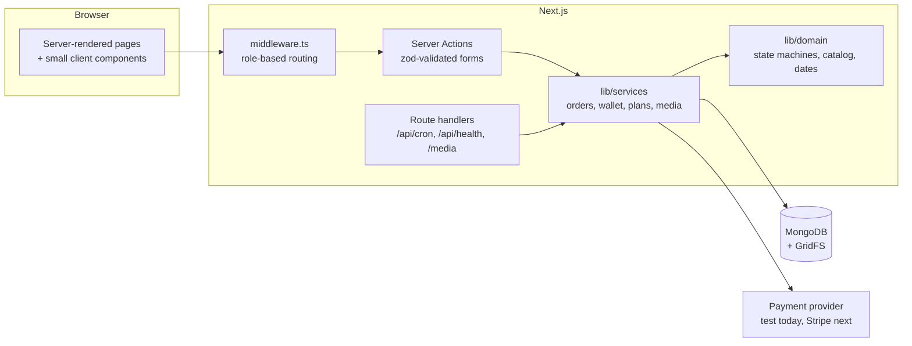

<div align="center">

# DiasporaConnect

**Look after family in Kosovo from wherever you live.**

Pay household bills, send gifts from local shops and book home services for your relatives,
share the costs with your siblings, and see proof that every order was done.

[](https://github.com/iligashi/albanian-diaspora-app-ka/actions/workflows/ci.yml)


</div>

---

## Contents

- [Why](#why)
- [Features](#features)
- [Quick start](#quick-start)
- [Configuration](#configuration)
- [Scripts](#scripts)
- [Architecture](#architecture)
- [Testing](#testing)
- [Deployment](#deployment)
- [Security](#security)
- [Contributing](#contributing)
- [Roadmap](#roadmap)

## Why

Hundreds of thousands of people from Kosovo live and work abroad, and many of them support parents and grandparents back home. Today that means bank transfers, cash handed over in summer, and phone calls to cousins to check whether the electricity bill was actually paid.

DiasporaConnect replaces that with one place where the family abroad can **pay, order, share the cost and see proof**, while local businesses get a steady stream of customers.

It is a three-sided marketplace:

| Role | What they do |
|---|---|
| **Customer** (lives abroad) | Saves family members, pays bills, orders gifts, books services, shares a wallet with siblings, sets up recurring plans |
| **Vendor** (local business) | Applies, gets approved, lists products or services, accepts orders, uploads delivery and visit photos |
| **Admin** (operations) | Approves vendors, pays utility providers and records receipts, issues refunds, runs scheduled jobs |

## Features

**Orders**
- **Bills**: electricity, water, internet, mobile, waste and rent across Kosovo's utility providers, settled by operations with a receipt number.
- **Gifts**: flowers, cakes and baskets from local shops, with delivery-area checks and an optional recorded voice message.
- **Home services**: cleaning, repairs, elderly care and wellbeing check-in visits, booked by date and time slot with no double-booking.
- Every order has a timeline, live status, refunds on cancellation and reviews that update the vendor's rating.

**Family**
- **Family wallets**: siblings share one balance, anyone can top up or pay from it, and the wallet shows who put in what.
- **Recurring plans**: any bill, gift or booking can repeat weekly to yearly and is placed ahead of time automatically.
- **Occasions**: family birthdays plus Albanian and Kosovo holidays on the dashboard, with a reminder 5 days before each birthday.
- **Proof**: vendors attach delivery and visit photos that only people on the order can see.
- **Yearly report** of everything sent home, by month, type and family member, printable to PDF.
- **Referrals**: an invite link (with WhatsApp sharing) that gives both people €5 wallet credit.

## Quick start

Requirements: **Node.js 20+** (22 recommended, see `.nvmrc`).

```bash
git clone https://github.com/iligashi/albanian-diaspora-app-ka.git
cd albanian-diaspora-app-ka
npm install
cp .env.example .env.local
```

In `.env.local`, set a session secret and use the in-memory database:

```bash
SESSION_SECRET=<run: node -e "console.log(require('crypto').randomBytes(48).toString('base64url'))">
MONGODB_URI=memory
```

```bash
npm run dev   # http://localhost:3000
```

`MONGODB_URI=memory` starts a throwaway MongoDB and fills it with demo data. The first run downloads the MongoDB binary (cached afterwards), and the data is gone when the server stops.

### Demo accounts

Password `demo-pass-2026` for all of them. These exist only in local demo data.

| Email | Role |
|---|---|
| `arben@demo.test` | Customer with family members, orders, a shared family wallet and a monthly plan |
| `besa@demo.test` | Arben's sister in Switzerland, shares the "Krasniqi family" wallet |
| `flora@demo.test` | Approved gift shop |
| `pastrim@demo.test` | Approved cleaning and check-in service |
| `admin@demo.test` | Operations |

### Using a real database

```bash
# .env.local
MONGODB_URI=mongodb://127.0.0.1:27017/diaspora-connect
SEED_ADMIN_EMAIL=you@example.com
SEED_ADMIN_PASSWORD=<at least 12 characters>
```

```bash
npm run seed            # creates the admin account
npm run seed -- --demo  # optional demo vendors, catalog and orders (refused in production)
```

## Configuration

All variables are validated at startup by [`lib/env.ts`](lib/env.ts); a missing or weak value stops the app with a clear message.

| Variable | Required | Description |
|---|---|---|
| `MONGODB_URI` | yes | MongoDB connection string, or `memory` for a seeded local database (blocked in production) |
| `SESSION_SECRET` | yes | At least 32 characters; signs session cookies |
| `NEXT_PUBLIC_APP_URL` | no | Public URL used for absolute links (default `http://localhost:3000`) |
| `PAYMENT_PROVIDER` | no | `test` is the only provider today: approves instantly, moves no money |
| `CRON_SECRET` | no | At least 24 characters; enables `/api/cron/daily` |
| `SEED_ADMIN_EMAIL`, `SEED_ADMIN_PASSWORD` | for `npm run seed` | First admin account |

## Scripts

| Command | What it does |
|---|---|
| `npm run dev` | Development server on port 3000 |
| `npm run build` / `npm start` | Production build / server |
| `npm run lint` | ESLint (Next.js core web vitals + TypeScript rules) |
| `npm run typecheck` | `tsc --noEmit` in strict mode |
| `npm test` | Unit tests: workflows, money, occasions, plan dates, redirects |
| `npm run test:integration` | Every workflow against a real in-memory MongoDB |
| `npm run check` | Lint, typecheck, unit and integration tests in one go (what CI runs before the build) |
| `npm run seed` | Admin account, plus demo data with `--demo` |

## Architecture



```
app/
  (auth)/                 login and register, with their server actions
  (app)/                  signed-in area: one shell, navigation per role
    dashboard, family, bills, gifts, services, activity, wallet, plans    customer
    vendor/               vendor workspace
    admin/                operations
    notifications, settings                                              every role
  api/cron/daily          scheduled plans and reminders (Bearer CRON_SECRET)
  api/health              liveness and database check
  media/[id]              access-checked photos and voice notes
lib/
  domain/                 pure logic: order state machines, catalog, occasions, plan dates
  services/               business logic: orders, wallet, plans, media, vendor, admin
  auth/                   password hashing, session tokens, safe redirects
  models.ts               Mongoose schemas
  validation.ts           zod schemas for every form
  payments.ts             payment provider interface
middleware.ts             role-based route protection
```

### Order workflows

Every status change goes through [`lib/domain/workflow.ts`](lib/domain/workflow.ts), which defines who may move an order to which status and whether that refunds the customer. The UI renders its action buttons from the same definitions, so the screens can't drift from the rules.

```
Gift order:  awaiting_payment → placed → accepted → out_for_delivery → delivered
                                  ├→ rejected  (vendor, refund)
                                  └→ cancelled (customer/admin, refund)

Booking:     awaiting_payment → requested → confirmed → in_progress → completed → review
                                  ├→ declined  (vendor, refund)
                                  └→ cancelled (customer/admin until work starts, refund)

Bill:        awaiting_payment → paid → settled  (admin records provider receipt)
                                  └→ refunded (admin, refund)
```

Status updates are **atomic compare-and-set** (`findOneAndUpdate` matching the expected current status), so two people acting at once can't both succeed and a refund can never happen twice.

### Money

- Amounts are **integer cents** in EUR; there is no floating-point money anywhere.
- A service fee (2.5%, min €0.99, max €9.99) is added on top. Vendors see their payout, customers see the breakdown.
- Every charge and refund is written to a `Transaction` ledger; wallet movements also go to a `WalletEntry` ledger with the balance after each entry.
- Wallet debits are a single atomic update guarded by `balanceCents >= amount`, so siblings paying at the same moment can never overdraw it. Refunds of wallet payments return to the wallet.
- Orders store a **snapshot** of the recipient and line items, so editing a family member or product never rewrites history.

### Recurring plans and scheduled jobs

Plans are placed ahead of their date (bills on the day, gifts 3 days and services 4 days before). `runDuePlans` claims each plan atomically, so overlapping runners never place the same order twice; after 3 failures in a row a plan pauses and the customer is told why.

`GET /api/cron/daily` with `Authorization: Bearer $CRON_SECRET` runs due plans and birthday reminders. It's safe to call more often than daily. Admins can also trigger it with **Run due plans**.

### Payments

[`lib/payments.ts`](lib/payments.ts) defines a `PaymentProvider` interface. The only implementation today is the **test provider**, which approves instantly and moves no money, and the UI says so. Adding Stripe means one more provider plus a webhook; order code doesn't change.

## Testing

```bash
npm run check
```

- **Unit tests** (`*.test.ts`, `node:test`) cover the order state machines, money maths, occasion dates (including 29 February and moving holidays), plan scheduling and the login redirect guard.
- **Integration tests** (`*.itest.ts`) run the real services against an in-memory MongoDB: payments and refunds, permission checks, double-booking, concurrent status changes, concurrent wallet debits, invites, recurring-plan runs with overlapping runners, auto-pause, referral rewards and upload validation.
- **CI** ([`.github/workflows/ci.yml`](.github/workflows/ci.yml)) runs lint, typecheck, both test suites and a production build on every pull request and every push to `main`.

## Deployment

The app is a standard Next.js server and runs anywhere Node.js 20+ does (Vercel, Render, Fly.io, a VM or a container).

1. Provision MongoDB (for example MongoDB Atlas) and set `MONGODB_URI`.
2. Set `SESSION_SECRET`, `NEXT_PUBLIC_APP_URL` and `CRON_SECRET`.
3. `npm ci && npm run build && npm start`, then run `npm run seed` once to create the first admin.
4. Schedule a daily `GET /api/cron/daily` with the `Authorization: Bearer <CRON_SECRET>` header.
5. Point your uptime monitor or load balancer at `GET /api/health`, which returns `200` when the database answers and `503` when it doesn't.

The built-in rate limiter is in memory, which is fine for one instance. Move it to Redis before running several.

## Security

- Sessions are signed JWTs in an **httpOnly, SameSite=Lax** cookie (secure in production); nothing sensitive is kept in browser storage.
- `middleware.ts` keeps each role in its own area, and every page and action also calls `requireUser()`, which re-reads the user so disabled accounts lose access immediately.
- All input is validated with zod on the server. Every query is scoped to its owner, vendor or admin; other people's ids return "not found".
- Passwords use bcrypt (cost 12). Login is rate limited and responds the same way for unknown emails.
- Post-login redirects only go to same-site paths (`//host` and `/\host` tricks are rejected).
- Uploads are size-limited and type-checked by their bytes, never by file name, and are served with a sandboxing CSP so they can never run as a page.
- Security headers: `X-Frame-Options`, `frame-ancestors`/`base-uri`/`object-src`/`form-action` CSP, `Permissions-Policy`, `Referrer-Policy`, `nosniff`, and HSTS in production.
- The app refuses to start without a strong `SESSION_SECRET`, and `MONGODB_URI=memory` is blocked in production.

Found a vulnerability? Please email the maintainer rather than opening a public issue.

## Contributing

1. Branch from `main` (`feat/…`, `fix/…`, `chore/…`).
2. Keep commits focused, with [Conventional Commit](https://www.conventionalcommits.org/) messages (`feat:`, `fix:`, `docs:`…).
3. Run `npm run check` before pushing. CI must be green before merging.
4. New business rules belong in `lib/domain` or `lib/services` with tests, not in components.

## Roadmap

- Stripe provider and webhook, with Apple Pay and Google Pay
- WhatsApp and Viber notifications for families back home
- Live bill lookup from utility providers
- Albanian and English translations, and an installable PWA
- "Family at home" mode for relatives in Kosovo to request things themselves
- Construction and property management, diaspora-season planning, associations, more countries
- Product images in object storage
- Redis-backed rate limiting for multi-instance deployments
- End-to-end tests (Playwright) for the main flows

---

<div align="center">
Built by <a href="https://github.com/iligashi">Ilaz Gashi</a>
</div>
